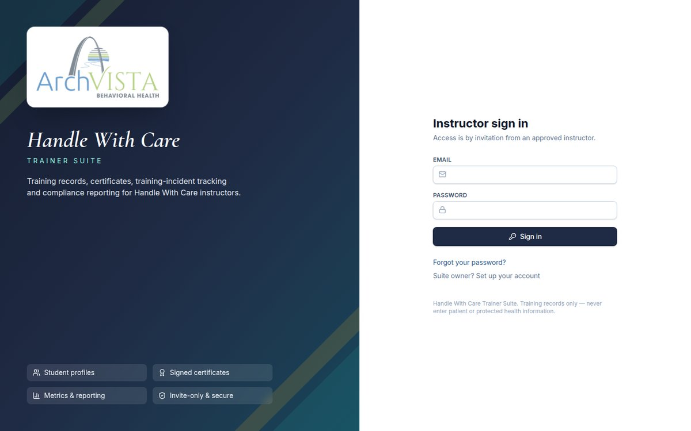
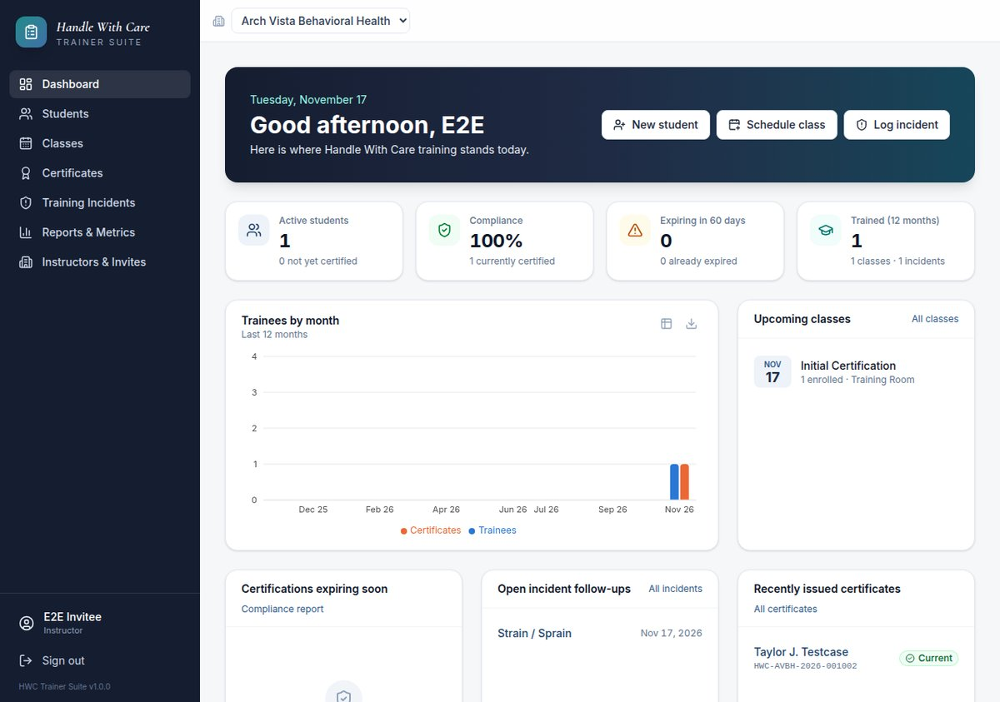
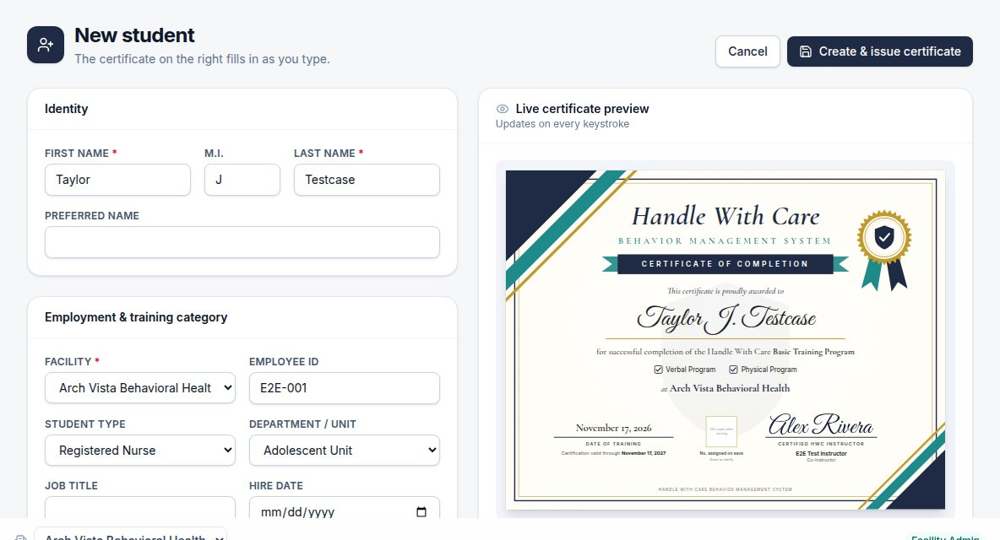
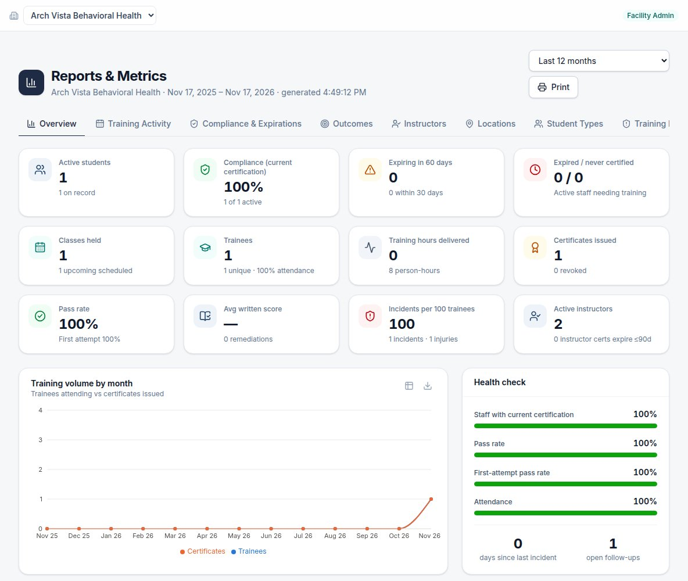
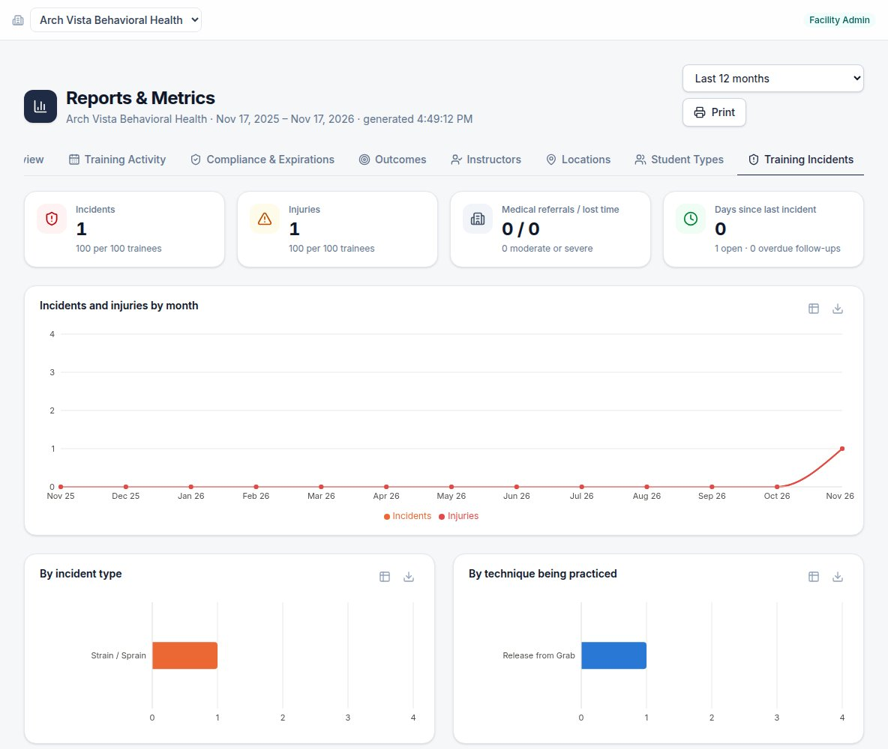
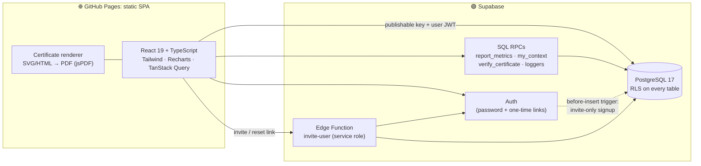
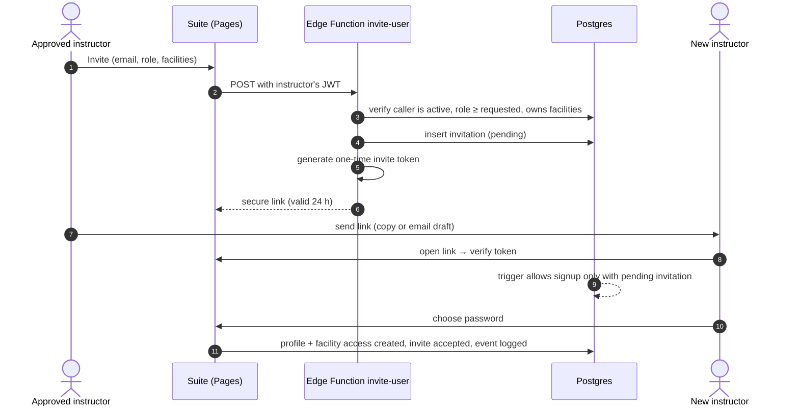
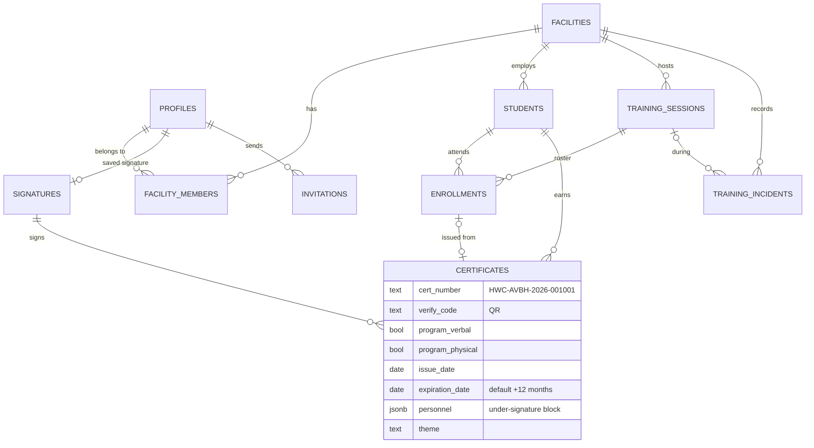
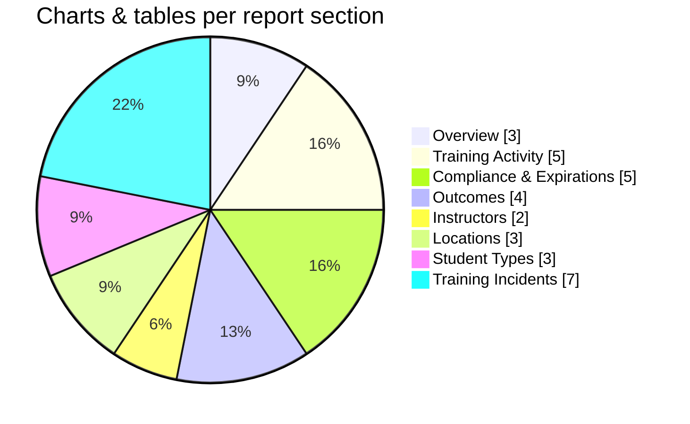
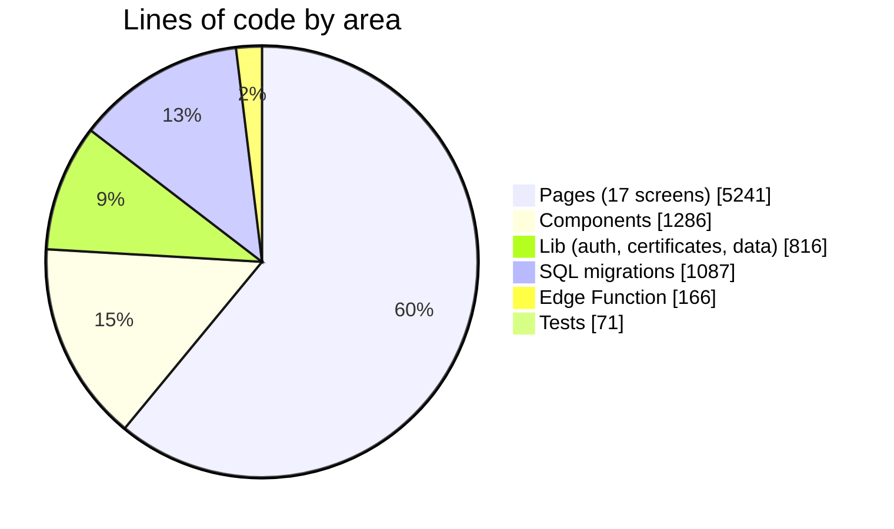

<div align="center">


# 🛡️ Handle With Care Trainer Suite

**An invite-only training CRM for Handle With Care (HWC) instructors: student profiles, signed and colored completion certificates, class rosters, training-incident tracking, and deep compliance reporting.**

[](https://github.com/paulmmoore3416/hwc-trainer-suite/actions/workflows/deploy.yml)
[](https://paulmmoore3416.github.io/hwc-trainer-suite/)
[](LICENSE)


[**🚀 Open the suite**](https://paulmmoore3416.github.io/hwc-trainer-suite/) · [Setup guide](docs/SETUP.md) · [Security model](SECURITY.md) · [Design spec](docs/superpowers/specs/2026-11-17-hwc-trainer-suite-design.md)

</div>

---

## ✨ At a glance

| | Feature | What it does |
|---|---|---|
| 👩‍🏫 | **Invite-only instructors** | Only an approved instructor can invite another. One-time secure links, self-chosen passwords, every invitation logged. |
| 🧑‍🎓 | **Student profiles** | Staff records with facility, employee ID, student type, department, job title, status and full training history. |
| 🪪 | **Live certificate preview** | As you type a new student's details, the colored certificate fills in instantly: name, facility, date, programs, signature and personnel. |
| ✍️ | **Digital signatures** | Draw, type, or reuse your saved signature. An editable personnel block sits under the signature (instructor, cert #, co-instructors, coordinators). |
| 🎨 | **Four original certificate themes** | Navy & Teal, Arch Vista Blue & Green, Crimson & Charcoal, Forest & Gold. PDF export and printing at print resolution. |
| 🔎 | **QR verification** | Every certificate carries a QR code and number that anyone can verify on a public page showing valid / expired / revoked. |
| 📅 | **Classes & rosters** | Schedule classes, enroll students, record attendance, verbal/physical competency and written scores, then **bulk-issue certificates**. |
| 🩹 | **Training-incident tracking** | Injuries and near misses during training, with technique, body part, severity, contributing factors and corrective-action follow-up. |
| 📊 | **Reports & metrics** | 8 report sections, 36 KPIs, 30+ charts and tables, CSV export, print-ready layouts. |
| 🧾 | **System logs (owner only)** | Error console, full audit trail with field-level diffs, sign-in and access events, health summary. |
| 🛠️ | **Editable without code** | Facilities, nine lookup lists, certificate defaults and themes can all be changed from the Administration screen. |

> [!IMPORTANT]
> **Training records only.** "Incidents" means accidents and near misses that happen *during HWC training*. Never enter patient names or protected health information.

## 📸 Screenshots

<table>
<tr>
<td width="50%"><br/><sub><b>Login</b>, with the facility logo</sub></td>
<td width="50%"><br/><sub><b>Dashboard</b>: KPIs, upcoming classes, expirations, follow-ups</sub></td>
</tr>
<tr>
<td colspan="2"><br/><sub><b>New student</b>: the certificate fills in as the profile is typed</sub></td>
</tr>
<tr>
<td width="50%"><br/><sub><b>Reports</b>: overview & health check</sub></td>
<td width="50%"><br/><sub><b>Training-incident analytics</b></sub></td>
</tr>
</table>

### 🎨 Certificate themes

<table>
<tr>
<td width="50%"><br/><sub>Navy & Teal (default)</sub></td>
<td width="50%"><br/><sub>Arch Vista Blue & Green</sub></td>
</tr>
<tr>
<td width="50%"><br/><sub>Crimson & Charcoal</sub></td>
<td width="50%"><br/><sub>Forest & Gold</sub></td>
</tr>
</table>

The certificate is an **original design** in the spirit of the HWC paper certificate: angled corner ribbons, a serif title, a script recipient name, program checkboxes, a seal, and date and signature lines. It does not reproduce HWC logo artwork. **Instructor certificates are intentionally not available in the suite.** Only student completion certificates can be generated.

## 🏗️ Architecture





### 🗄️ Data model



## 🔐 Roles & permissions

| Capability | Instructor | Facility admin | Super admin |
|---|:---:|:---:|:---:|
| Students, classes, certificates, incidents (own facilities) | ✅ | ✅ | ✅ all facilities |
| Invite instructors to own facilities | ✅ | ✅ | ✅ |
| Invite facility admins | | ✅ | ✅ |
| Deactivate instructors / issue reset links | | ✅ | ✅ |
| Delete students, certificates, classes | | ✅ | ✅ |
| Change roles | | | ✅ |
| Facilities, editable lists, certificate settings | | | ✅ |
| **System logs** (errors, audit trail, sign-ins) | | | ✅ owner only |

Super-admin accounts are defined in a private database allow-list (`private.super_admin_emails`). They are **not** stored in this public repository.

## 📊 Reports & metrics catalog



| Section | Highlights |
|---|---|
| **Overview** | 12 KPI tiles, training volume trend, health-check meters (compliance, pass rate, first-attempt pass, attendance), days since last incident, compliance by facility |
| **Training Activity** | Classes, hours and trainees by month, passed vs not passed, day-of-week distribution, course-type table with pass rates |
| **Compliance & Expirations** | 12-month expiration forecast, status by department, live lists of expiring (90 d), expired and never-certified staff |
| **Outcomes** | Pass / first-attempt pass rates, results by course and student type, average written score, remediation counts, certificates by program |
| **Instructors** | Trainees per lead instructor, scorecard (classes, hours, pass rate, incidents, instructor-cert expiry) |
| **Locations** | Classes and incidents by facility and room, facility compliance summary |
| **Student Types** | Certification status by student type, students by department, record status |
| **Training Incidents** | Incidents and injuries per 100 trainees, monthly trend, by type / technique / body part / contributing factor / severity / involved person, follow-up status |

Every chart has a **table view** and **CSV export**. All aggregation runs in Postgres (`report_metrics`, `security invoker`), so it scales to large datasets and respects each user's facility access.

## 📦 Codebase at a glance



```
hwc-trainer-suite/
├── src/
│   ├── pages/            Dashboard, Students, StudentForm, Classes, Certificates, Incidents, Reports, Team, Admin, Logs …
│   ├── components/       Certificate renderer, SignaturePad, CertificateFields, charts, UI kit, Layout
│   └── lib/              Supabase client, auth context, certificate builder, error logging, formatting, CSV
├── supabase/
│   ├── migrations/       Schema · RLS & security · reporting · seed · views
│   └── functions/        invite-user Edge Function
├── tests/                Vitest unit tests
├── docs/                 Setup guide, design spec, screenshots
└── .github/workflows/    Build, test & deploy to GitHub Pages
```

## 🚀 Quick start (local development)

```bash
git clone https://github.com/paulmmoore3416/hwc-trainer-suite.git
cd hwc-trainer-suite
npm ci
npm run dev        # http://localhost:5173
npm test           # unit tests
npm run build      # typecheck + production build
```

The app points at the production Supabase project by default. To use your own, copy `.env.example` to `.env` and set `VITE_SUPABASE_URL` / `VITE_SUPABASE_PUBLISHABLE_KEY`, then apply `supabase/migrations/*` in order and deploy `supabase/functions/invite-user`. Full steps are in **[docs/SETUP.md](docs/SETUP.md)**.

## 🛡️ Security highlights

- **Row Level Security on every table.** Instructors only ever see their own facilities' data. Logs are visible to the owner only.
- **Invite-only at the database level.** A `before insert` trigger on `auth.users` rejects any signup without a pending invitation.
- **Privilege-escalation guard.** Users cannot change their own role, status or email, and the super-admin role is reserved.
- **Service-role key never leaves the server.** Privileged actions run in the `invite-user` Edge Function after verifying the caller.
- **Audit trail.** Field-level before/after diffs on all core tables. Errors and sign-in events are logged with rate limiting.
- **Strict Content-Security-Policy** in production, CSV formula-injection protection, and one-time, 24-hour invite and reset links.

See [SECURITY.md](SECURITY.md) for the full model.

## ⚖️ Notice

"Handle With Care" and the HWC Behavior Management System are trademarks of their respective owner. This suite is an independent record-keeping tool built for a certified HWC instructor. It is not affiliated with or endorsed by Handle With Care, and it does not reproduce HWC logo artwork. The Arch Vista Behavioral Health logo belongs to Arch Vista Behavioral Health and appears on the login page for the facility's own use.

<div align="center"><sub>Built for HWC instructors · © 2026</sub></div>
